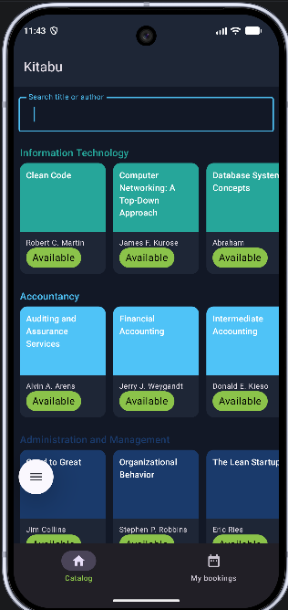
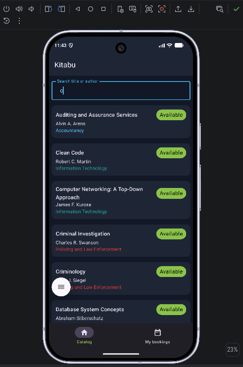
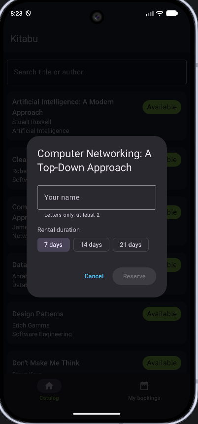
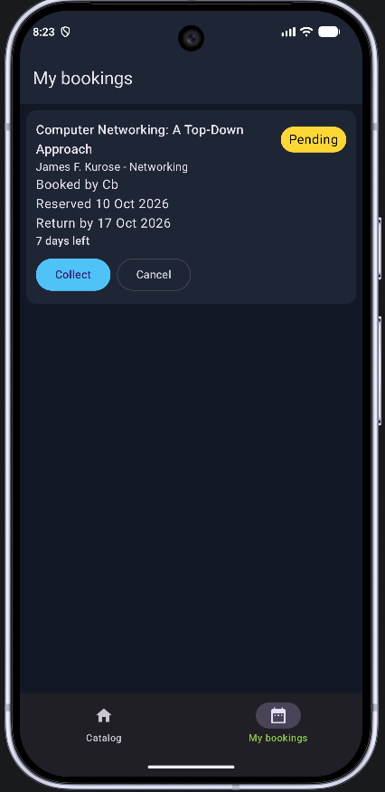
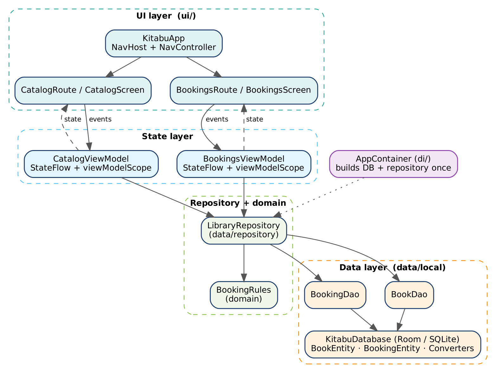
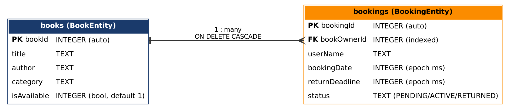
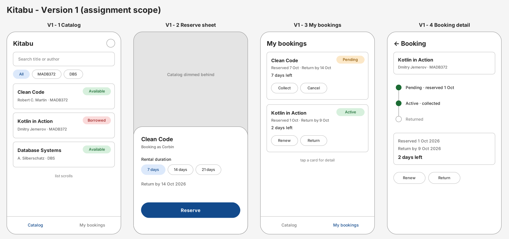

# Kitabu: Library Book Rental & Reservation System

**MADB372 Mobile Application Development B, SF1 project**
Corbin Benjamin · STADIO School of Information Technology

Kitabu ("book" in Swahili) is a native Android app that lets students browse a library catalogue, reserve a title, and manage the whole rental lifecycle (**collect, renew, return or cancel**) with live availability and full offline storage.

Built with **Kotlin**, **Jetpack Compose (Material 3)**, **Room (SQLite)**, **MVVM**, **Coroutines** and **Kotlin Flow**.

---

## Features

| Feature | Details |
|---|---|
| Catalogue | Books grouped on horizontal shelves per STADIO school, each with a green **Available** or orange **Borrowed** badge |
| Search | Filters by title or author while you type (SQL `LIKE '%query%'`) |
| Reserve | Tap an available book → dialog with name validation and a 7 / 14 / 21 day duration |
| My bookings | Live dashboard of pending and active bookings with booking date, return deadline and days left / overdue |
| Lifecycle | **Collect** (PENDING → ACTIVE), **Renew** (+7 days, max 42-day loan), **Return** (frees the book), **Cancel** (pending only) |
| Reactive UI | Badges and lists update immediately when the database changes, with no manual refresh |
| Offline | Everything is stored locally in Room; the catalogue is pre-populated with 33 sample books on first launch |

## Screenshots

| Catalog | Search | Reserve | My bookings |
|---|---|---|---|
|  |  |  |  |

<!-- TODO: add after testing: 05-borrowed-badge.png, 06-active-booking.png, 07-renewed.png, 08-returned.png, 09-cancelled.png -->

### CRUD operations

| Operation | Where in the app | DAO method |
|---|---|---|
| **Create** | Reserve a book | `BookingDao.reserveBook` (`@Transaction`), `BookDao.insertBooks` (seed) |
| **Read** | Catalogue, search, My bookings | `BookDao.searchBooks`, `BookDao.getBooksByAvailability`, `BookingDao.getBookingsWithBook` (JOIN) |
| **Update** | Collect, Renew, Return | `BookingDao.updateStatus`, `updateReturnDeadline`, `returnBook` (`@Transaction`) |
| **Delete** | Cancel a pending booking | `BookingDao.cancelBooking` (`@Transaction`) |

## Architecture

Kitabu follows **MVVM** with a repository layer and manual dependency injection.



```
UI (Compose screens) ──events──▶ ViewModel ──▶ Repository ──▶ DAO ──▶ Room (SQLite)
        ▲                              │
        └──── StateFlow ◀──────── Flow ◀┘
```

- **UI (`ui/`)**: `Route` composables collect state with `collectAsStateWithLifecycle()`; `Screen` composables are stateless (state hoisting) and previewable.
- **ViewModel**: converts Room `Flow`s to `StateFlow` with `stateIn(WhileSubscribed(5000))`; all writes run in `viewModelScope.launch`.
- **Repository (`data/repository`)** + **domain (`domain/`)**: one source of data; validates input and applies the loan rules in `BookingRules`.
- **Data (`data/local`)**: `KitabuDatabase`, `BookDao`, `BookingDao`, entities and type converters.
- **DI (`di/`)**: `AppContainer` builds the database and repository once.

### Database



- `BookEntity`: `bookId` (PK, auto), `title`, `author`, `category`, `isAvailable` (default `true`)
- `BookingEntity`: `bookingId` (PK, auto), `bookOwnerId` (FK → `bookId`, **CASCADE** delete, indexed), `userName`, `bookingDate`, `returnDeadline`, `status` (`PENDING` / `ACTIVE` / `RETURNED`)
- `@Database(version = 1)` with `@TypeConverters` (enum ↔ TEXT), a thread-safe `@Volatile` + `synchronized` singleton, and a `RoomDatabase.Callback` that seeds sample books on `Dispatchers.IO`.

### Project structure

```
app/src/main/java/com/stadiolinks/kitabu
├── data/
│   ├── local/          KitabuDatabase, Converters, SampleBooks
│   │   ├── dao/        BookDao, BookingDao
│   │   ├── entity/     BookEntity, BookingEntity, BookingStatus
│   │   └── model/      BookingWithBook
│   └── repository/     LibraryRepository
├── di/                 AppContainer
├── domain/             BookingRules, Schools
└── ui/
    ├── catalog/        CatalogScreen, CatalogViewModel
    ├── bookings/       BookingsScreen, BookingsViewModel
    ├── navigation/     KitabuApp (NavHost)
    └── theme/          Colours, typography, theme
```

## Design

Wireframes were drawn before development (`design/kitabu-wireframes.svg`).



## Getting started

### Requirements
- Android Studio (Ladybug or newer)
- JDK 17+
- Android device or emulator running **API 26+**

### Run the app
1. Clone the repository:
   ```bash
   git clone https://github.com/<username>/Kitabu_MADB372_SF1.git
   ```
2. Open the folder in Android Studio (**File → Open**).
3. Let Gradle sync finish (dependencies are in `gradle/libs.versions.toml`).
4. Select an emulator or device and press **Run ▶**.

On first launch the database is created and filled with sample books automatically.

## Tech stack

| | |
|---|---|
| Language | Kotlin |
| UI | Jetpack Compose, Material 3, Navigation Compose |
| Persistence | Room 2.8 (SQLite) with **KSP** |
| Async | Kotlin Coroutines, Flow, StateFlow |
| Architecture | MVVM + Repository, manual DI |
| Min / target SDK | 26 / 37 |

## AI use declaration

Claude (Anthropic) was used for feedback on the code against the marking criteria, guidance on GitHub setup, and help drafting this README and the project documentation, as permitted (Amber) by the assignment's AI Traffic Light Matrix. Prompts and outputs are included in the submitted document.
